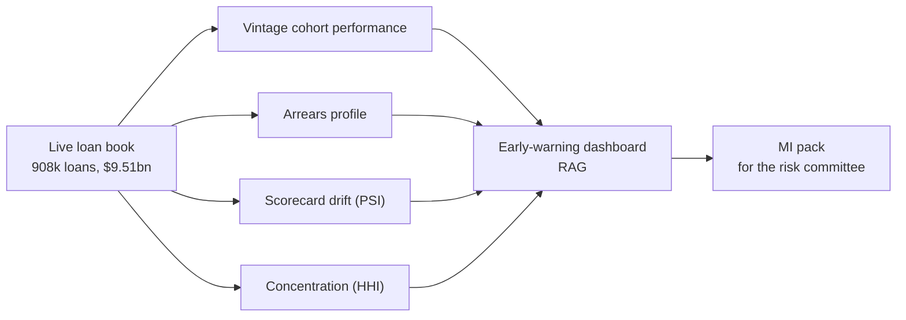
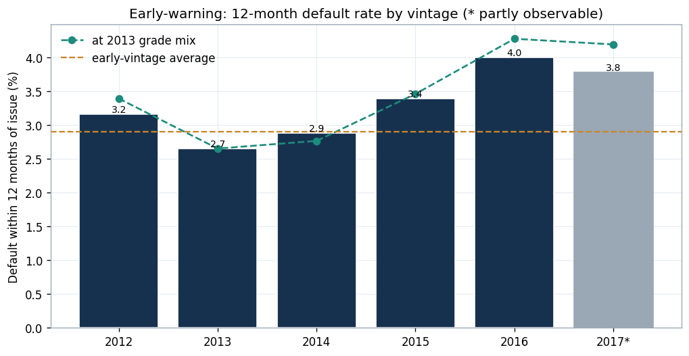
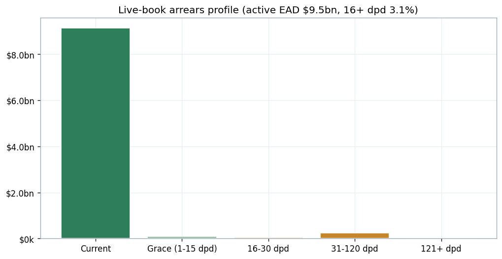
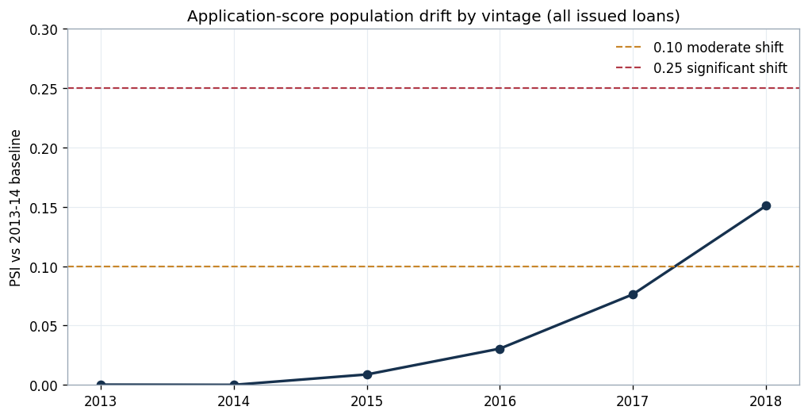
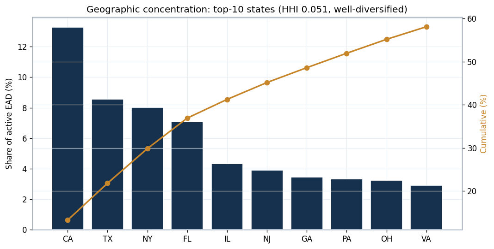

# Credit Risk Monitoring and MI Pack

**A portfolio credit-risk monitoring suite on real loans: vintage performance, delinquency, model drift, concentration, and a RAG early-warning dashboard, assembled into a committee-ready management-information pack.**

This project is the oversight and reporting side of credit risk. It takes a live loan book and produces the monitoring a risk function runs and the management information it presents to its committees: how each origination vintage is performing, where the book sits on arrears, whether the scorecard is still stable, how concentrated the exposure is, and a single early-warning dashboard that rolls it up with red, amber and green flags. The committee pack is in [`MI_PACK.md`](MI_PACK.md).

---

## Headline: overall AMBER

The book performs on a cash basis (low arrears, well diversified) but two forward-looking signals warrant attention: origination quality is deteriorating, even after allowing for the shift in grade mix, and the newest applicants' risk profile is drifting from the baseline.

Reporting date: March 2019, the latest payment date in the data. Default is dated at last payment plus four months (about 90 days past due), and each vintage's 12-month default rate counts only loans whose full 12 months had passed by the reporting date.

| Indicator | Reading | Status |
|---|---|---|
| Vintage 12-month default trend | 4.0% on the 2016 vintage, up from 2.7% (2013); 4.3% at 2013 grade mix | RED |
| Live-book delinquency (16+ days past due) | 3.1% of active EAD | GREEN |
| Arrears 31+ days past due | 2.6% of active EAD | GREEN |
| Application-score drift (PSI) | 0.15, 2018 vintage vs 2013-14 | AMBER |
| Geographic concentration (HHI) | 0.051, top-5 states 41% | GREEN |
| Product concentration | 58% of EAD in one purpose | AMBER |

Portfolio: 907,904 active loans, $9.51bn exposure at default.

---

## What it monitors



- **Vintage cohort performance.** Cumulative default by months on book for each origination cohort, the standard way to see whether newer lending is performing worse than older lending.
- **Arrears.** The live book by arrears bucket, and the share of exposure 16+ and 31+ days past due.
- **Application-score drift.** Population Stability Index of every issued loan's application score by vintage, against the 2013-14 baseline, so a changing applicant population is caught early.
- **Concentration.** Herfindahl-Hirschman indices and top-exposure shares by geography and product.
- **Early-warning dashboard.** A RAG roll-up of the above, the page a committee reads first.

---

## Figures, with interpretation

**Vintage cohort curves.** 
The 2016 cohort sits above every earlier cohort throughout its life, and 2015 moves above the 2012 to 2014 cohorts from about a year on book; the gap then widens. By 24 months, 11.9% of the 2016 vintage had defaulted against 8.8% of 2013. Newer lending is defaulting faster.

**12-month default by vintage.** 
The share defaulting within 12 months of issue has risen from 2.7% (2013) to 4.0% (2016), about 37% above the 2012-13 average. Restated at the 2013 grade mix (dashed line) the rise is slightly larger (4.3%), so it is not just a move towards riskier grades. The 2017 bar is greyed because only loans issued early in 2017 have a full 12 months observed.

**Delinquency profile.** 
Exposure by arrears bucket. The book is overwhelmingly current; 3.1% of active exposure is 16 or more days past due and 2.6% is 31 or more.

**Scorecard drift.** 
Population Stability Index of the application score by vintage, against 2013-14, scored on every issued loan. It stays low until 2017 (0.08) and reaches the moderate-shift band in 2018 (0.15), a signal to review the scorecard.

**Concentration.** 
Top-10 states by exposure with the cumulative share. With an HHI of 0.051 the book is well-diversified geographically.

**Early-warning dashboard.** 
The RAG roll-up: two reds and ambers to watch, the rest green. This is the committee's first page.

**Risk-band default, early vs recent.** 
12-month default rate by PD band (eighths) for 2013-14 versus 2016-17 vintages. Recent vintages default more in every band, at the same modelled risk: the calibration drift behind the dashboard's red and amber flags.

---

## Relevance

This is the monitoring and management-information half of a credit-risk function: vintage and delinquency monitoring, model surveillance, concentration and large-exposure oversight, and committee reporting with clear escalation. The deliverable is written as an MI pack with a RAG dashboard and recommended actions, which is the form this reporting takes in practice. For an auto or captive-finance book the same pack would add daily single-counterparty large-exposure monitoring on the dealer side, a direct extension of the concentration analysis here.

---

## Run it

```bash
pip install -r requirements.txt
# download accepted_2007_to_2018Q4.csv.gz from Kaggle into data/raw/ (or set LENDING_CLUB_CSV to its path)
python build_dataset.py   # builds data/lending_affordability.parquet, used for the application-score drift
python analysis.py        # builds all monitoring metrics, figures, and results.json
pip install jupytext nbclient ipykernel && python make_notebook.py   # optional: rebuild the notebook
```

The notebook is generated from `analysis.py` (written in notebook cell format) and executed, so the two always match.

## Repository structure

```
.
├── analysis.py                       # vintage / arrears / drift / concentration / EWI pipeline (cells marked for the notebook)
├── credit_risk_monitoring.ipynb      # generated from analysis.py and executed
├── MI_PACK.md                        # the committee-ready management-information pack (read this)
├── results.json                      # all metrics quoted here and in the pack
├── CHANGES.md                        # what changed and why, with old and new numbers
├── build_dataset.py                  # builds the modelling table from the raw Kaggle file
├── lending_club.py                   # shared loader: outcome windows, snapshot, default dating
├── make_notebook.py                  # converts analysis.py to the notebook and runs it
├── figures/                          # seven charts
├── data/
│   └── exposure_by_state.csv         # exposure and share by state
├── requirements.txt
├── LICENSE
└── README.md
```

## Limitations

- **Approximate default dating.** The file has no month-by-month delinquency history, so default is dated at last payment plus four months, and roll rates between arrears buckets cannot be measured.
- **One snapshot.** Lending Club published a single cut of the data, so this is one month's pack; trends come from comparing vintages rather than successive months.
- **Partly observed recent vintages.** The 2017 12-month rate covers only early-2017 issues, and late-2016 loans had not quite completed 24 months plus the charge-off allowance in the cumulative curves.
- **Illustrative limits.** The RAG thresholds are set in `analysis.py` as reasonable defaults, not a lender's calibrated risk appetite.

## Data

The underlying **Lending Club** loan data (accepted loans 2007-2018, via Kaggle) is publicly available and used here for a non-commercial portfolio project; neither the raw file nor the derived modelling table is redistributed. The **code** is released under the MIT License (see `LICENSE`).
