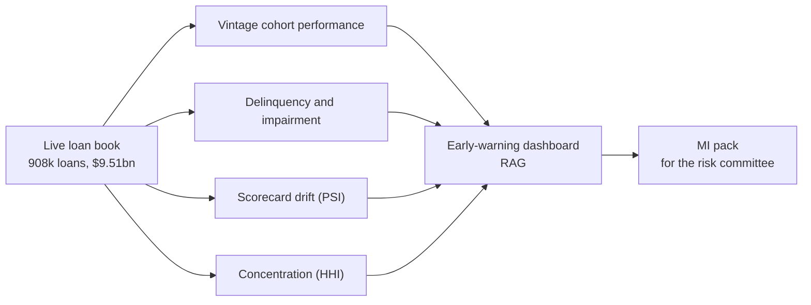
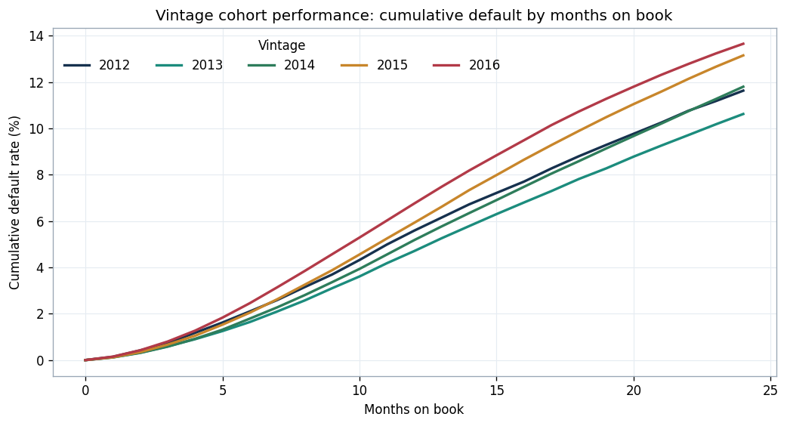
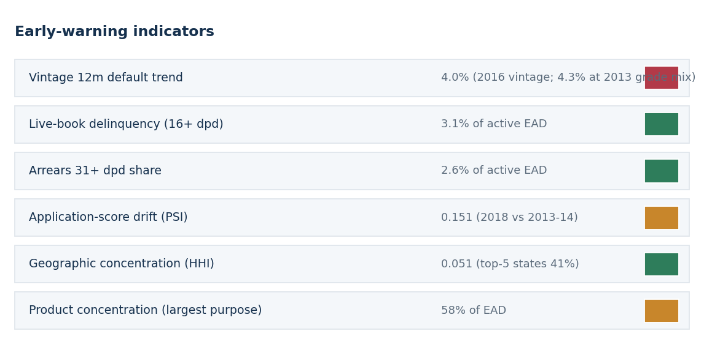
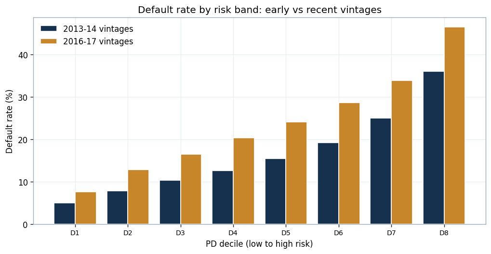

# Credit Risk Monitoring and MI Pack

**A portfolio credit-risk monitoring suite on real loans: vintage performance, delinquency, model drift, concentration, and a RAG early-warning dashboard, assembled into a committee-ready management-information pack.**

This project is the oversight and reporting side of credit risk. It takes a live loan book and produces the monitoring a risk function runs and the management information it presents to its committees: how each origination vintage is performing, where the book sits on delinquency and impairment, whether the scorecard is still stable, how concentrated the exposure is, and a single early-warning dashboard that rolls it up with red, amber and green flags. The committee pack is in [`MI_PACK.md`](MI_PACK.md).

---

## Headline: overall AMBER

The book performs on a cash basis (low delinquency, well diversified) but two forward-looking signals warrant attention: origination quality is deteriorating and the scorecard's population is drifting.

| Indicator | Reading | Status |
|---|---|---|
| Vintage 12-month default trend | 6.8% latest mature vintage, up from 4.7% | RED |
| Live-book delinquency rate | 3.1% of active EAD | GREEN |
| Impaired (30+ days past due) | 2.6% of active EAD | GREEN |
| Scorecard population drift (PSI) | 0.13 vs baseline | AMBER |
| Geographic concentration (HHI) | 0.051, top-5 states 41% | GREEN |
| Product concentration | 58% of EAD in one purpose | AMBER |

Portfolio: 907,904 active loans, $9.51bn exposure at default.

---

## What it monitors



- **Vintage cohort performance.** Cumulative default by months on book for each origination cohort, the standard way to see whether newer lending is performing worse than older lending.
- **Delinquency and impairment.** The live book by arrears bucket, and the share of exposure that is delinquent or impaired.
- **Scorecard drift.** Population Stability Index of the model's score distribution over time, against thresholds, so model decay is caught early.
- **Concentration.** Herfindahl-Hirschman indices and top-exposure shares by geography and product.
- **Early-warning dashboard.** A RAG roll-up of the above, the page a committee reads first.

---

## Figures, with interpretation

**Vintage cohort curves.** 
The 2015 and 2016 cohorts sit above the 2012 to 2014 cohorts at every point in their life. Newer lending is defaulting faster.

**12-month default by vintage.** 
The early-default rate has risen from 4.7% (2013) to 6.8% (2016), about a third higher than the early-vintage average. The latest bar is greyed because that vintage is only partly observed.

**Delinquency profile.** 
Exposure by arrears bucket. The book is overwhelmingly current; delinquency is 3.1% of active exposure.

**Scorecard drift.** 
Population Stability Index by vintage against the development baseline. It has climbed into the moderate-shift band, a signal to review the model.

**Concentration.** 
Top-10 states by exposure with the cumulative share. With an HHI of 0.051 the book is well-diversified geographically.

**Early-warning dashboard.** 
The RAG roll-up: two reds and ambers to watch, the rest green. This is the committee's first page.

**Risk-band default, early vs recent.** 
Default rate by model risk decile for early versus recent vintages. Recent vintages default more at the same modelled risk, the calibration drift behind the dashboard's amber flags.

---

## Relevance

This is the monitoring and management-information half of a credit-risk function: vintage and delinquency monitoring, model surveillance, concentration and large-exposure oversight, and committee reporting with clear escalation. The deliverable is written as an MI pack with a RAG dashboard and recommended actions, which is the form this reporting takes in practice. For an auto or captive-finance book the same pack would add daily single-counterparty large-exposure monitoring on the dealer side, a direct extension of the concentration analysis here.

---

## Run it

```bash
pip install -r requirements.txt
python analysis.py        # builds all monitoring metrics, figures, and results.json
```

## Repository structure

```
.
├── analysis.py                       # vintage / delinquency / drift / concentration / EWI pipeline
├── credit_risk_monitoring.ipynb      # the same pipeline as an executed notebook
├── MI_PACK.md                        # the committee-ready management-information pack (read this)
├── results.json                      # all metrics
├── figures/                          # seven charts
├── data/
│   └── exposure_by_state.csv         # exposure and share by state
├── requirements.txt
├── LICENSE
└── README.md
```

## Data

The underlying **Lending Club** loan data is publicly available and used here for a non-commercial portfolio project. The **code** is released under the MIT License (see `LICENSE`).
